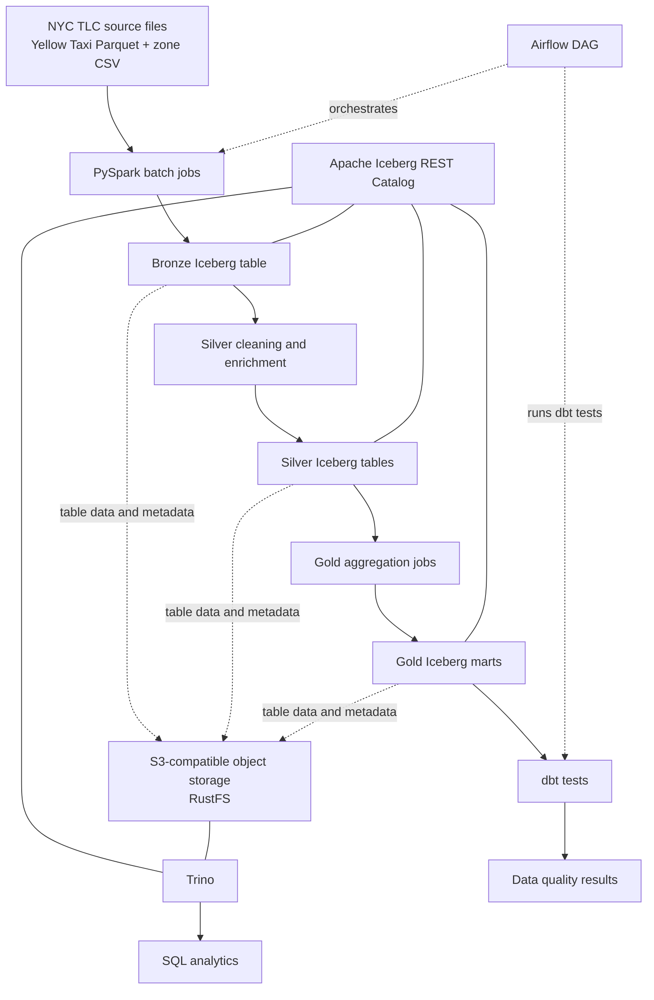
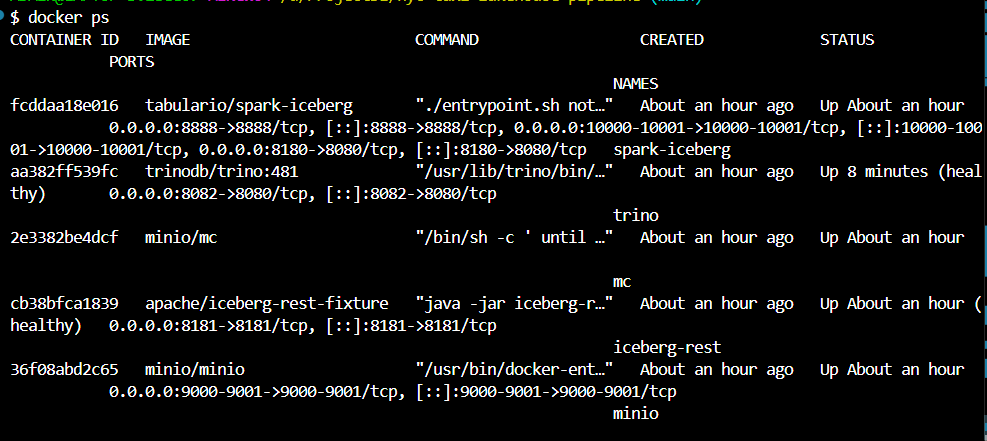
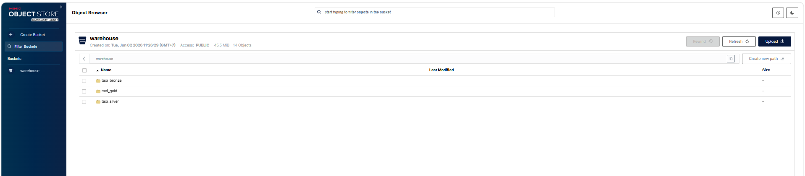
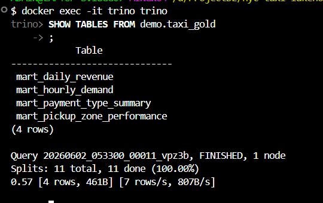
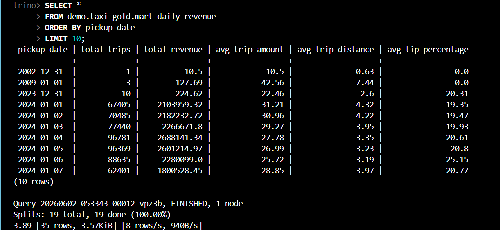
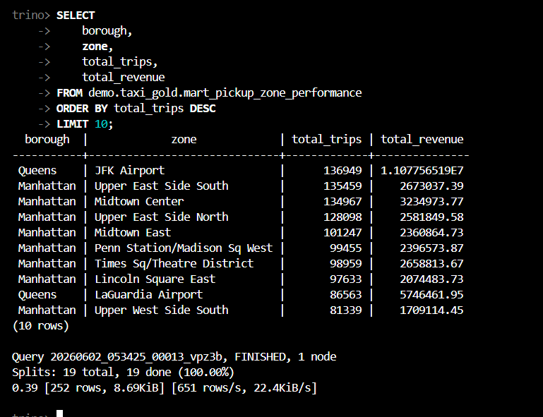
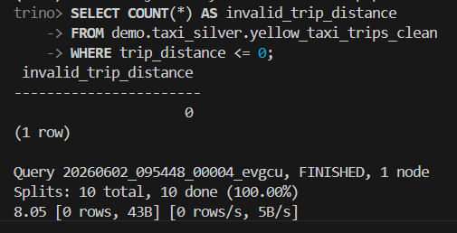
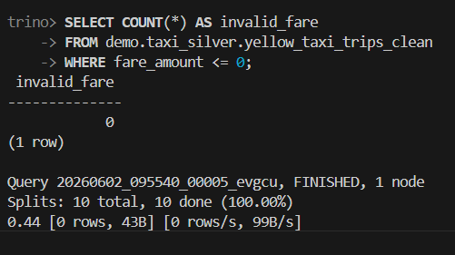
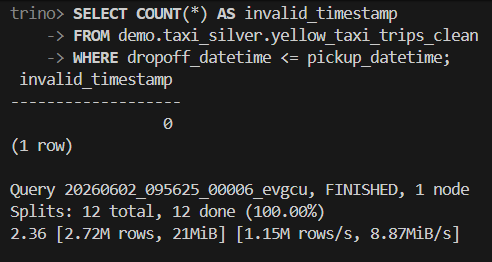
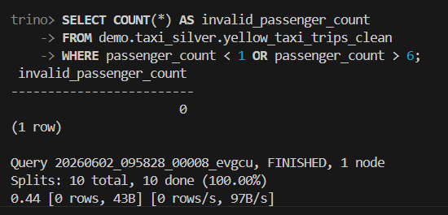

# NYC Taxi Lakehouse Pipeline


An end-to-end local lakehouse pipeline for NYC Yellow Taxi trip data. PySpark batch jobs ingest and transform Parquet data into Apache Iceberg tables, S3-compatible object storage holds the table data, Trino provides SQL access, and dbt validates data quality. Docker Compose runs the local infrastructure, while an Airflow DAG coordinates the pipeline tasks.

## Overview

The project demonstrates a medallion-style data architecture with three layers:

- **Bronze:** Raw Yellow Taxi trip records ingested from Parquet into an Iceberg table, with ingestion metadata.
- **Silver:** Standardized and validated trip records, enriched with analytical columns. A separate zone lookup table provides pickup-zone descriptions.
- **Gold:** Four aggregated data marts for daily revenue, hourly demand, pickup-zone performance, and payment-type analysis.

The current sample input is the January 2024 Yellow Taxi Parquet file. The ingestion job accepts a year and month, so another monthly file can be processed when it is placed in `data/raw`.

## Architecture



### Data Flow

1. Load the taxi zone reference CSV into `taxi_silver.taxi_zones`.
2. Ingest the selected monthly Parquet file into `taxi_bronze.yellow_taxi_trips`.
3. Clean and enrich the Bronze records into `taxi_silver.yellow_taxi_trips_clean`.
4. Aggregate Silver data into four tables in the `taxi_gold` schema.
5. Query the Iceberg tables through Trino and run dbt data quality tests.

## Tech Stack

| Technology | Purpose |
| --- | --- |
| Python | Implements the Spark jobs and supporting pipeline code |
| Apache Spark / PySpark | Batch ingestion, validation, transformation, and aggregation |
| Apache Iceberg | Open table format providing table metadata, snapshots, and schema evolution |
| Iceberg REST Catalog | Catalog service used by Spark and Trino to discover Iceberg tables |
| RustFS | S3-compatible object storage for Iceberg data and metadata files |
| Trino | SQL query engine for analytics on Iceberg tables |
| dbt + dbt-trino | Source-level and custom SQL data quality tests |
| Apache Airflow | Defines task dependencies and manually triggered pipeline orchestration |
| Docker Compose | Runs the local services and their network |

> **Storage implementation note:** The Compose service is named `minio` and uses MinIO-style environment variable names and endpoint settings for compatibility, but the current Compose file runs `rustfs/rustfs:latest` (with `rustfs/rc` for bucket initialization). RustFS is the S3-compatible object-storage implementation in this repository; the project does not currently run the `minio/minio` image.

## Repository Structure

```text
.
|-- airflow/
|   |-- Dockerfile
|   `-- dags/
|       `-- nyc_taxi_lakehouse_dag.py
|-- data/
|   `-- raw/
|       |-- taxi_zone_lookup.csv
|       `-- yellow_tripdata_2024-01.parquet
|-- dbt_taxi/
|   |-- dbt_project.yml
|   |-- profiles.yml
|   |-- models/
|   |   `-- sources.yml
|   `-- tests/
|       |-- assert_no_invalid_fare.sql
|       |-- assert_no_invalid_passenger_count.sql
|       |-- assert_no_invalid_timestamp.sql
|       `-- assert_no_invalid_trip_distance.sql
|-- docs/
|   `-- dashboard_screenshots/
|-- spark/
|   |-- jobs/
|   |   |-- 00_load_zone.py
|   |   |-- 01_bronze_ingest.py
|   |   |-- 02_silver_clean.py
|   |   `-- 03_gold_marts.py
|   `-- utils/
|       `-- spark_session.py
|-- trino/
|   `-- catalog/
|       `-- demo.properties
|-- warehouse/
|-- .env.example
|-- docker-compose.yml
`-- README.md
```

## Data Source

Download the NYC TLC Yellow Taxi trip data and taxi zone lookup file, then place them in `data/raw/`:

- `yellow_tripdata_2024-01.parquet` — Yellow Taxi trip records for January 2024.
- `taxi_zone_lookup.csv` — Lookup data mapping location IDs to boroughs and taxi zones.

The `data/raw` directory must be populated locally. The Spark container accesses these files through the project directory volume mount.

## Pipeline Details

### 1. Load Taxi Zones

**Script:** `spark/jobs/00_load_zone.py`

- Reads `taxi_zone_lookup.csv`.
- Renames lookup columns to lowercase snake_case.
- Casts `location_id` to an integer.
- Writes/replaces `taxi_silver.taxi_zones`.

This reference table is used by the Gold pickup-zone mart to translate pickup location IDs into borough and zone names.

### 2. Bronze Ingestion

**Script:** `spark/jobs/01_bronze_ingest.py`

Accepts `--year` and `--month`, reads the corresponding monthly Parquet file, and writes/replaces `taxi_bronze.yellow_taxi_trips`.

It adds the following metadata columns:

- `source_file` — Source Parquet filename.
- `ingestion_timestamp` — Timestamp when the Spark job ingests the data.
- `year` and `month` — Year and month supplied to the job.

Example:

```bash
spark-submit spark/jobs/01_bronze_ingest.py --year 2024 --month 01
```

### 3. Silver Cleaning and Enrichment

**Script:** `spark/jobs/02_silver_clean.py`

Reads the Bronze table, standardizes selected source column names, and applies validation predicates to remove records with:

- Null pickup or drop-off timestamps.
- Drop-off timestamp earlier than or equal to pickup timestamp.
- Zero or negative trip distance.
- Zero or negative fare amount or total amount.
- Passenger count outside the inclusive range 1–6.
- Null pickup or drop-off location IDs.

The job derives six analytical columns:

| Column | Meaning |
| --- | --- |
| `trip_duration_minutes` | Difference between drop-off and pickup timestamps, in minutes |
| `pickup_date` | Calendar date extracted from pickup timestamp |
| `pickup_hour` | Hour extracted from pickup timestamp (0–23) |
| `pickup_day_of_week` | Day-of-week value extracted from pickup timestamp |
| `fare_per_mile` | Fare amount divided by trip distance |
| `tip_percentage` | Tip amount divided by fare amount, multiplied by 100 |

The cleaned output is written/replaced as `taxi_silver.yellow_taxi_trips_clean`.

### 4. Gold Data Marts

**Script:** `spark/jobs/03_gold_marts.py`

Builds four aggregated Iceberg tables in the `taxi_gold` schema:

| Table | Grain / Grouping | Example Metrics |
| --- | --- | --- |
| `mart_daily_revenue` | One row per pickup date | Trip count, total revenue, average trip amount, average distance, average tip percentage |
| `mart_hourly_demand` | One row per pickup hour | Trip count, total revenue, average trip duration |
| `mart_pickup_zone_performance` | One row per borough and zone | Trip count, total revenue, average distance, average trip amount |
| `mart_payment_type_summary` | One row per payment type | Trip count, total revenue, average tip percentage |

The pickup-zone mart uses a `LEFT JOIN` from cleaned trips to the taxi-zone lookup table using `pickup_location_id = location_id`.

## Storage and Table Access

### Apache Iceberg and the REST Catalog

Spark writes the Bronze, Silver, and Gold datasets as Iceberg tables. The REST Catalog provides table metadata access to Spark and Trino. Iceberg tracks table metadata and snapshots, while the underlying data files are stored in the S3-compatible object store.

### RustFS Object Storage

The Compose file runs RustFS and exposes its S3-compatible API on port `9000` and its console on port `9001`. The `mc` service (using `rustfs/rc`) waits for the object store and creates the configured bucket if it does not already exist.

### Trino

Trino connects to the Iceberg REST Catalog through `trino/catalog/demo.properties` and exposes the tables for SQL analysis.

Example queries:

```sql
SHOW SCHEMAS FROM demo;
SHOW TABLES FROM demo.taxi_gold;

SELECT *
FROM demo.taxi_gold.mart_daily_revenue
ORDER BY pickup_date;

SELECT borough, zone, total_trips, total_revenue
FROM demo.taxi_gold.mart_pickup_zone_performance
ORDER BY total_trips DESC
LIMIT 10;
```

## Data Quality with dbt

The dbt project is in `dbt_taxi/` and uses the `dbt-trino` adapter.

### Generic Tests

`sources.yml` declares source tests across the Bronze, Silver, and Gold tables, including:

- `not_null` checks on important metadata, dimensions, timestamps, and measures.
- `unique` checks on the taxi-zone `location_id` and selected Gold mart keys such as `pickup_date`, `pickup_hour`, and `payment_type`.

### Custom Singular Tests

The `tests/` directory contains four SQL assertions:

- `assert_no_invalid_fare.sql`
- `assert_no_invalid_passenger_count.sql`
- `assert_no_invalid_timestamp.sql`
- `assert_no_invalid_trip_distance.sql`

A dbt singular test passes when its query returns zero violating rows. It fails when one or more invalid rows are returned.

## Airflow Orchestration

The Airflow DAG is defined in `airflow/dags/nyc_taxi_lakehouse_dag.py` with DAG ID `nyc_taxi_lakehouse_pipeline`.

Its five tasks run in this dependency order:

```text
load_taxi_zones
      >> bronze_ingest
      >> silver_clean
      >> gold_marts
      >> dbt_test
```

The Spark tasks use `docker exec` to submit jobs to the `spark-iceberg` container. The final task runs `dbt test` from the Airflow project mount.

The DAG has `schedule=None` and `catchup=False`, so it is **manually triggered**, not scheduled. The Bronze task accepts `year` and `month` from the DAG run configuration (defaults: `2024` and `01`).

> **Airflow/dbt connection note:** The committed `dbt_taxi/profiles.yml` currently sets the Trino host to `localhost`, which is suitable when running dbt from the host machine. When dbt is executed inside the Airflow container, use the Compose service hostname `trino` as the host in the profile (or make the host configurable with an environment variable). Otherwise, `localhost` inside the Airflow container refers to the Airflow container itself, not the Trino service.

## Getting Started

### Prerequisites

- Docker Engine and Docker Compose.
- The two NYC TLC source files listed in [Data Source](#data-source).
- Python and `dbt-trino` only if you plan to run dbt from your host machine rather than through the Airflow container.

### 1. Configure Environment Variables

Copy the example file and set local credentials:

```bash
cp .env.example .env
```

The example configuration includes:

```env
MINIO_ROOT_USER=change_me
MINIO_ROOT_PASSWORD=change_me
MINIO_ACCESS_KEY=change_me
MINIO_SECRET_KEY=change_me

MINIO_ENDPOINT=http://minio:9000
MINIO_REGION=us-east-1
MINIO_BUCKET=warehouse

ICEBERG_REST_URI=http://rest:8181
ICEBERG_WAREHOUSE=s3://warehouse/
ICEBERG_CATALOG=demo

TRINO_PORT=8082
TRINO_USER=admin
```

Use non-default credentials for your local environment. These are development settings, not production secrets management.

### 2. Add the Source Data

Place the monthly Parquet file and zone lookup CSV in `data/raw/`.

### 3. Start the Services

From the repository root:

```bash
docker compose up -d --build
```

Check service status:

```bash
docker compose ps
```

The Compose stack includes Spark, the Iceberg REST Catalog, RustFS object storage, the bucket initialization client, Trino, and Airflow.

### 4. Run the Spark Jobs Manually

The following commands run the four Spark jobs in the required order:

```bash
docker exec -it spark-iceberg bash -lc "cd /home/iceberg/project && spark-submit spark/jobs/00_load_zone.py"
docker exec -it spark-iceberg bash -lc "cd /home/iceberg/project && spark-submit spark/jobs/01_bronze_ingest.py --year 2024 --month 01"
docker exec -it spark-iceberg bash -lc "cd /home/iceberg/project && spark-submit spark/jobs/02_silver_clean.py"
docker exec -it spark-iceberg bash -lc "cd /home/iceberg/project && spark-submit spark/jobs/03_gold_marts.py"
```

### 5. Run dbt Tests from the Host (Optional)

The committed profile uses `localhost:8082`, so this command is intended to run from the host machine:

```bash
cd dbt_taxi
dbt test --profiles-dir .
```

If running dbt inside a Compose container, configure the profile host as `trino` instead of `localhost`.

### 6. Trigger the Airflow DAG (Optional)

Open the Airflow UI at `http://localhost:8081`, sign in using the credentials printed by the Airflow standalone container, enable `nyc_taxi_lakehouse_pipeline`, and trigger it manually.

To process a different month, provide DAG run configuration such as:

```json
{
  "year": "2024",
  "month": "02"
}
```

Make sure the corresponding Parquet file exists in `data/raw/` before triggering the DAG. Also apply the Airflow/dbt Trino-host configuration note above before relying on the final dbt task.

## Local Service Endpoints

| Service | Local Address | Purpose |
| --- | --- | --- |
| RustFS Console | `http://localhost:9001` | Browse object-storage buckets |
| S3-compatible API | `http://localhost:9000` | Object-storage endpoint (container-to-container endpoint: `http://minio:9000`) |
| Iceberg REST Catalog | `http://localhost:8181` | Catalog service endpoint |
| Trino | `http://localhost:8082` | SQL query endpoint |
| Airflow UI | `http://localhost:8081` | DAG management and task logs |
| Spark UI / service port | `http://localhost:8888` | Spark container's exposed notebook/service port |

## Screenshots

### Docker Services



### Object Storage Bucket



### Trino Gold Tables



### Query Results





### Data Quality Checks









## Key Engineering Concepts Demonstrated

- Medallion architecture (Bronze, Silver, Gold).
- Batch ingestion and transformation with PySpark.
- Iceberg table management through a REST Catalog.
- S3-compatible object storage.
- SQL analytics through Trino.
- Data quality validation with dbt generic and singular tests.
- Workflow dependencies and manual DAG triggering with Airflow.
- Local, reproducible infrastructure using Docker Compose.

## Current Limitations and Implementation Notes

- The repository does not include the raw taxi Parquet and CSV source files; they must be downloaded and added locally.
- The sample dataset is one month (January 2024), although the ingestion job accepts a year and month argument.
- The Spark jobs use `createOrReplace()` for their output tables. Re-running a job replaces the table contents; this is a batch full-refresh pattern, not an incremental append or merge strategy.
- The Airflow DAG is manually triggered because `schedule=None`.
- The dbt profile currently targets `localhost:8082`, which is appropriate for host execution; use `trino` as the hostname when executing dbt inside the Airflow container.
- The current object-storage container is RustFS, not the MinIO server image. It exposes an S3-compatible API and retains the `minio` Compose service name for configuration compatibility.
- Credentials in `.env.example` are placeholders for local development and should be changed.

## Future Improvements

- Make the dbt Trino hostname configurable for both host and container execution.
- Add incremental Iceberg writes or partition-aware MERGE logic instead of replacing complete tables.
- Add support for multiple months and years, with a defined strategy for combining monthly inputs.
- Add retries, alerting, and a recurring Airflow schedule where appropriate.
- Add dbt models for Gold transformations if transformations are moved from Spark into dbt.
- Add a BI dashboard on top of Trino.
- Add CI checks for Python formatting, DAG validation, and dbt tests.
